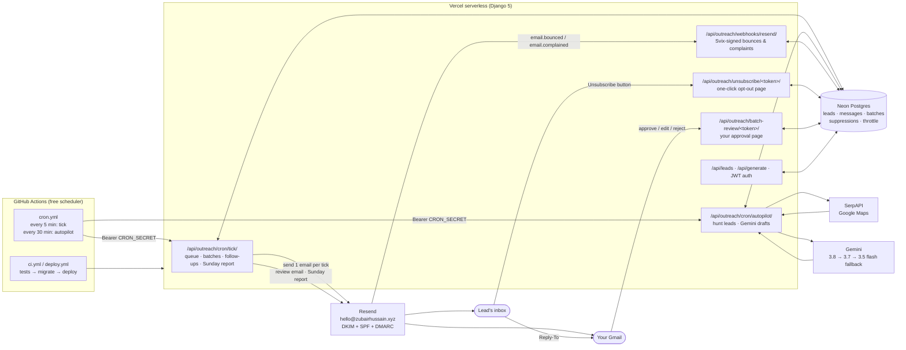
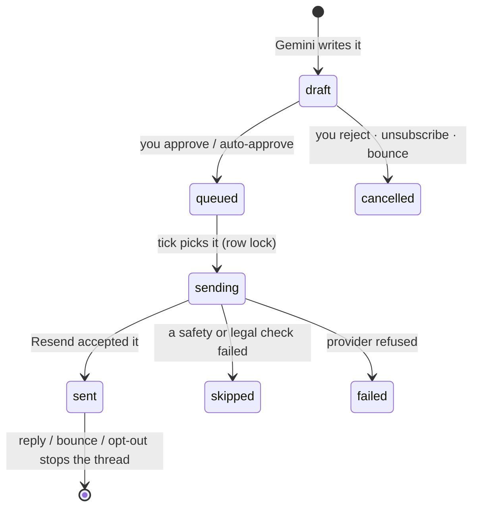

<div align="center">

# LeadGen Backend

**Stop chasing strangers. Start winning buyers.**

An autonomous B2B outreach engine: it finds local businesses every morning, writes each one a short
personal email, sends from your own domain within the law of the lead's country, stops the moment
someone replies, and emails you a report every Sunday.

[](https://github.com/Zubair-hussain/leadgen-backend/actions/workflows/ci.yml)
[](https://github.com/Zubair-hussain/leadgen-backend/actions/workflows/deploy.yml)


<a href="docs/assets/leadgen-demo.mp4">
  
</a>

<sub>▶ The preview loops on its own. <a href="docs/assets/leadgen-demo.mp4">Play the full 20-second video with sound (MP4)</a>.</sub>

</div>

---

## Contents

- [What it does](#what-it-does)
- [A day in the life](#a-day-in-the-life)
- [System architecture](#system-architecture)
- [Inbox, not spam](#inbox-not-spam)
- [The law, per country](#the-law-per-country)
- [Security and reverse engineering](#security-and-reverse-engineering)
- [API](#api)
- [Deploy (Vercel, free)](#deploy-vercel-free)
- [Configuration](#configuration)
- [Operating it](#operating-it)
- [Troubleshooting (real incidents)](#troubleshooting-real-incidents)
- [Pro tip: find bugs faster](#pro-tip-find-bugs-faster)
- [Book a call](#book-a-call)

## What it does

| | |
| --- | --- |
| 🔎 **Finds leads** | Google Maps (SerpAPI) by niche and city, rotating through your target list. Reads each business website for a real, working email (MX checked). Optional Apify deep crawl, Yelp, Nextdoor, True Local. |
| ✍️ **Writes like a person** | Gemini drafts a 50-100 word email that opens with *their* business and offers the one service that fits: no website → design & layout, has a website → a free security check or SEO check. A humanizer and a playbook score (Cold Email Hall of Fame rules) reject anything robotic. |
| ✅ **Asks you first** | Drafts are grouped into **one** review email. Approve, edit or reject in one click, or let auto-send release only the drafts that pass every check after a few hours. |
| 📬 **Sends like a person** | From `hello@yourdomain` through Resend: 5 a day, 3-8 random minutes apart, 07:00-11:00 in the **lead's** time zone, weekdays only. |
| 🔁 **Follows up politely** | Up to 3 follow-ups in the same thread (days 3, 4, 7), stopped instantly by a reply, a bounce or an unsubscribe. |
| 🛡️ **Protects your domain** | One-click unsubscribe (RFC 8058), bounce and spam-complaint webhook, per-day and per-hour caps. |
| 📊 **Reports to you** | Every Sunday 18:00: emails sent, replies, reply rate, new leads, bounces, opt-outs, sent per day, health warnings. |

## A day in the life

```
07:00 PKT      Autopilot hunts leads for today's target ("dentists|Austin, TX; plumbers|Manchester, UK; ...")
07:30 onward   Gemini drafts 2 emails per run (6 a day), each run kept under Vercel's 300 s limit
+2 min quiet   Drafts are batched into ONE review email to you
+3 h           No answer? Drafts that pass every check are auto-approved; doubtful ones are held
07:00 local    Up to 5 emails a day leave hello@, 07:00-11:00 in each lead's own time zone
any time       Reply → follow-ups stop · bounce/spam → address blocked forever · unsubscribe → blocked
Sunday 18:00   Weekly report lands in your inbox
```

## System architecture



**Why it is shaped this way**

- **No always-on server.** Vercel has no background workers, so a free GitHub Actions cron calls two
  small endpoints. Each call does one bounded step and returns. With Celery + Redis (Docker) the same
  jobs run from Celery Beat instead.
- **One email per tick.** A database row lock (`SendThrottle`) plus random 3-8 minute gaps make the
  sending pattern look like a person, and two overlapping ticks can never double-send.
- **The database is the state machine.** Every message moves `draft → queued → sending → sent`
  (or `skipped` / `failed` / `cancelled`), so a crashed or timed-out call simply resumes next tick.



## Inbox, not spam

What Gmail (Feb 2024), Yahoo and Outlook (May 2025) require, and how this backend meets it:

| Rule | How it is met |
| --- | --- |
| SPF + DKIM aligned with the From domain | Resend DKIM on the root domain, SPF and bounce MX on `send.` |
| DMARC record | `_dmarc` TXT, start at `p=none`, move to `p=quarantine` after clean weeks |
| One-click unsubscribe | `List-Unsubscribe` (https + mailto) and `List-Unsubscribe-Post: List-Unsubscribe=One-Click` |
| Spam complaints < 0.3 % | complaints suppressed by webhook; Sunday report flags any |
| Honest headers and subject | no fake `Re:`/`Fwd:`, max 2 links, real `Message-ID`, plain-text twin of every HTML email |
| Look human | no tracking pixels, no click tracking, short emails, random gaps, business hours only, warm-up |

## The law, per country

| Region | Law | What the code does |
| --- | --- | --- |
| 🇺🇸 US | CAN-SPAM | "one-to-one business offer" line, sender name and postal address, opt-out that works for 30+ days |
| 🇬🇧 UK | PECR + UK GDPR | business addresses only, says where the address came from, legitimate interest, right to object |
| 🇪🇺 EU | ePrivacy + GDPR | same as UK; **Germany and Austria blocked** (prior consent needed) |
| 🇦🇺 AU | Spam Act 2003 | business addresses only, published-address notice, opt-out |
| 🌍 other | e.g. Canada CASL | **never emailed**: unknown regions are blocked |

Enforced in [`outreach/compliance.py`](outreach/compliance.py). Not legal advice.

## Security and reverse engineering

Nobody can stop someone from reading code in a public repository. The protection here does not
depend on hiding the code: everything valuable lives on the server, and every entry point checks a
secret the attacker does not have.

| Threat | Protection |
| --- | --- |
| **Reading the frontend to steal keys** | The browser never holds a provider key. SerpAPI, Gemini, Resend, Google and the database URL exist only as Vercel *sensitive* env vars; the UI talks to this API with a short-lived JWT. |
| **Keys leaking through git** | `.env*` is git-ignored; gitleaks and pip-audit run on every push and every Monday (`security.yml`). |
| **Calling the scheduler yourself** | `/cron/*` requires `Authorization: Bearer $CRON_SECRET`, compared in constant time (`hmac.compare_digest`). Wrong or missing secret → 401. |
| **Forging bounce events** | The Resend webhook verifies the Svix HMAC-SHA256 signature and rejects anything older than 5 minutes (replay protection). |
| **Guessing review or unsubscribe links** | Links carry a Django-signed token, not a bare id. Tampering → 400. Review links expire after 7 days. |
| **Link scanners unsubscribing people** | GET only shows a confirm button; only a POST (button or mail-app one-click) unsubscribes. |
| **Using the crawler to reach internal services (SSRF)** | Website fetches resolve DNS first and refuse private, loopback, link-local and reserved IPs, also after redirects. |
| **Prompt injection from scraped websites** | Gemini prompts mark lead facts as *data, not instructions*; an independent Gemini review plus the humanizer and playbook gates must all pass before auto-send. |
| **Script injection on server pages** | Strict CSP with no script source at all, `X-Frame-Options: DENY`, `nosniff`, HSTS in production. |
| **Brute force / scraping the API** | DRF throttling (60/h anonymous, 1000/h per user), owner-scoped querysets, admin moved to a secret `ADMIN_URL`. |
| **Leaking data in logs** | Logs never print API keys or tokens. |

**Want the code itself private?** Make this repository private (Settings → General → Danger zone).
Vercel keeps deploying, and GitHub Actions minutes for private repos are still free up to 2,000 a month.

## API

| Method | Path | Auth | Purpose |
| --- | --- | --- | --- |
| GET | `/api/health/` | none | liveness check |
| POST | `/api/token/firebase/` | Firebase ID token | exchange Google sign-in for a JWT |
| POST | `/api/generate/` | JWT | find leads now |
| GET | `/api/leads/` · `/api/leads/export/` | JWT | list / CSV export |
| POST | `/api/leads/verify-single/` · `verify-multi/` · `verify-file/` | JWT | email verification |
| POST | `/api/deliverability/check/` | JWT | SPF/DMARC/DKIM inbox-risk score |
| GET | `/api/outreach/status/` | JWT | queue, limits, transport |
| POST | `/api/outreach/ai-drafts/` | JWT | draft emails for chosen leads |
| POST | `/api/outreach/cron/tick/` | `CRON_SECRET` | send · batch · follow-ups · Sunday report |
| POST | `/api/outreach/cron/autopilot/` (`?hunt=1` to re-hunt now) | `CRON_SECRET` | find leads · write drafts |
| POST | `/api/outreach/webhooks/resend/` | Svix signature | bounces and complaints |
| GET/POST | `/api/outreach/unsubscribe/<token>/` | signed token | one-click opt-out |

## Deploy (Vercel, free)

1. Vercel → **Add New → Project** → import this repo. Framework: **Django**. Root directory: `.`
2. Add the env vars below (Vercel → Settings → Environment Variables; paste a whole `.env` at once).
3. GitHub → Settings → Secrets → Actions: `BACKEND_URL`, `CRON_SECRET`, `DATABASE_URL`, `SECRET_KEY`.
4. Actions → **Database migrate** → Run workflow (first deploy and after model changes).
5. Resend → add your domain (DKIM + `send.` SPF/MX), create an API key, and a webhook to
   `/api/outreach/webhooks/resend/` for `email.bounced` and `email.complained`.
6. Open `https://<your-backend>.vercel.app/api/health/`.

Every push to `main` deploys automatically.

## Configuration

<details>
<summary><b>Environment variables</b> (click to open)</summary>

| Variable | Example | Meaning |
| --- | --- | --- |
| `OUTREACH_TRANSPORT` | `resend` | `resend`, `smtp` or `gmail` |
| `OUTREACH_FROM_EMAIL` / `OUTREACH_FROM_NAME` | `hello@zubairhussain.xyz` / `Zubair Hussain` | sender |
| `OUTREACH_REPLY_TO` | `you@gmail.com` | where replies and mailto opt-outs go |
| `RESEND_API_KEY` / `RESEND_WEBHOOK_SECRET` | `re_…` / `whsec_…` | Resend sending + webhook signature |
| `OUTREACH_DRY_RUN` | `True` | everything runs, nothing leaves |
| `OUTREACH_DAILY_MIN` / `OUTREACH_DAILY_LIMIT` / `OUTREACH_HOURLY_LIMIT` | `5` / `5` / `5` | caps |
| `OUTREACH_SEND_HOUR_START` / `_END` / `OUTREACH_WEEKDAYS_ONLY` | `7` / `11` / `True` | window, in each lead's time zone |
| `OUTREACH_SEND_TIMEZONE` | *(empty)* | set e.g. `Asia/Karachi` to use one clock for everyone |
| `OUTREACH_AUTOPILOT_ENABLED` / `_OWNER` | `True` / `you@gmail.com` | daily hunt + drafts, owner account |
| `OUTREACH_AUTOPILOT_TARGETS` | `dentists\|Austin, TX; cafes\|Melbourne, VIC` | one target per day, rotating |
| `OUTREACH_AUTOPILOT_TIMEZONE` / `_HOUR` / `_DRAFTS_PER_DAY` | `Asia/Karachi` / `7` / `6` | when it starts, how many drafts |
| `OUTREACH_AUTO_SEND_ENABLED` / `_AFTER_HOURS` | `True` / `3` | release passing drafts if you do not answer |
| `OUTREACH_SENDER_ADDRESS` | `Pakistan` | printed in every email (CAN-SPAM wants a full postal address) |
| `OUTREACH_BOOKING_URL` / `OUTREACH_SERVICES` | `https://…` / `Website security checks,Design & layout,SEO` | signature card |
| `OUTREACH_IMAP_HOST` / `_USER` / `_PASSWORD` | `imap.gmail.com` / `you@gmail.com` / app password | read replies |
| `OUTREACH_WEEKLY_REPORT_ENABLED` / `OUTREACH_REPORT_TIMEZONE` / `_HOUR` | `True` / `Asia/Karachi` / `18` | Sunday report |
| `GEMINI_MODEL` / `GEMINI_FALLBACK_MODELS` / `GEMINI_TIMEOUT_SECONDS` | `gemini-3.8-flash` / `gemini-3.7-flash,gemini-3.5-flash` / `30` | AI writer |
| `SERPAPI_KEY`, `GEMINI_API_KEY`, `DATABASE_URL`, `SECRET_KEY`, `CRON_SECRET`, `ADMIN_URL` | | secrets: set as *sensitive* in Vercel |

</details>

## Operating it

```bash
python manage.py send_test_email            # the exact branded email a lead gets, to your inbox
python manage.py send_test_email --to <mail-tester.com address>   # spam score
python manage.py send_weekly_report --print # preview the Sunday report
python manage.py preview_outreach_email     # write the email to an HTML file
python manage.py process_outreach_queue     # one send step by hand
python -m pytest                            # 223 tests
```

Pause everything: set `OUTREACH_DRY_RUN=True` in Vercel and redeploy.
Re-run today's hunt after changing targets: `POST /api/outreach/cron/autopilot/?hunt=1` with the cron secret.

## Troubleshooting (real incidents)

Every row below happened while taking this to production. The [closed issues](https://github.com/Zubair-hussain/leadgen-backend/issues?q=is%3Aissue+is%3Aclosed) hold the details.

| Symptom | Cause | Fix |
| --- | --- | --- |
| Scheduler log: `Secrets not set yet, skipping.` | GitHub secrets missing | add `BACKEND_URL` and `CRON_SECRET` |
| `relation "auth_user" does not exist` | migrations never ran on the new database | Actions → Database migrate |
| `owner-not-found` | fresh database has no users | autopilot now creates the owner exactly like Google sign-in |
| `hunted 0 new leads` + `[Errno 16] Device or resource busy` | one website crashed the whole Maps search | each website is now isolated; full traceback logged |
| `Gemini returned 503/429` | model overloaded or rate limited | automatic fallback to other flash models; leads are kept for retry, never shelved |
| `Task timed out after 300 seconds` | slow Gemini × retries | 30 s per request and a 2-minute drafting budget per run |
| `invalid literal for int() … ''` at build | env vars saved empty by an old CLI syntax | set with `vercel env add NAME --environment production --value …` |
| New endpoints return 404 | the monorepo was deployed instead of this repo | deploy this repo only (Vercel Git integration) |

## Pro tip: find bugs faster

Working on this project (or any app) with an AI assistant? Paste this prompt first:

> **find all the implicit state machines in my app**

Most bugs live in state nobody wrote down: a status field, a "last run" marker, a retry counter, a
flag that is only valid between two calls. Listing every implicit state machine shows the missing
transitions (what happens if a draft is approved twice? if a send times out half way? if the hunt
runs before 07:00?). That is exactly how the stuck-lead and double-hunt cases above were found.

## Book a call

<div align="center">

<a href="https://calendly-booking-navy.vercel.app/">
  
</a>

**Website security checks · Design & layout · SEO**
<br>
<a href="https://calendly-booking-navy.vercel.app/">📅 Book a free 15-minute call</a> · <a href="https://zubairhussain.xyz">🌐 zubairhussain.xyz</a>

<sub>Built by Zubair Hussain · ⭐ Star the repo if it helped you</sub>

</div>
